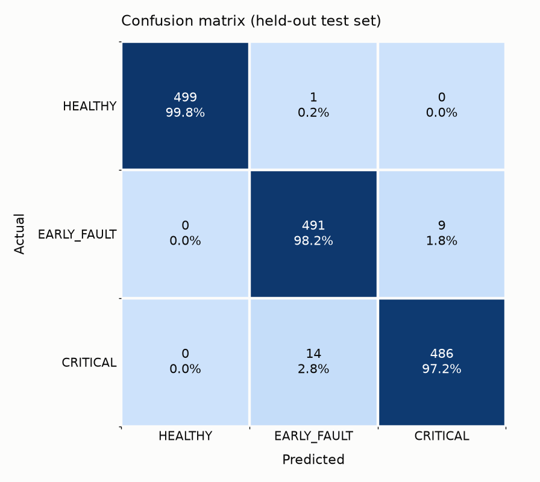
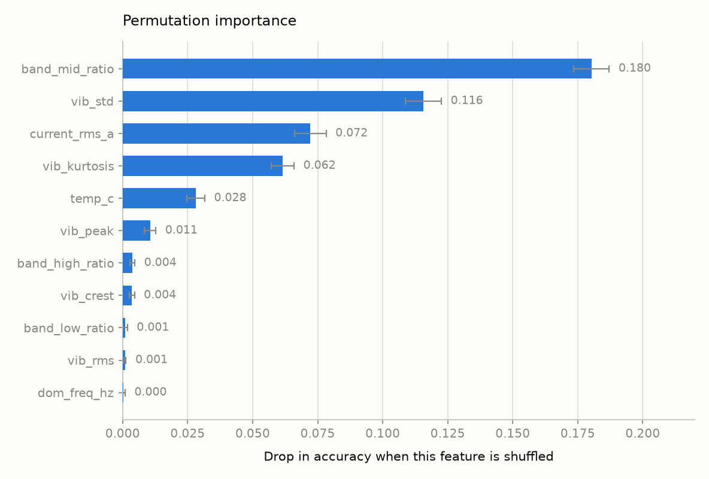
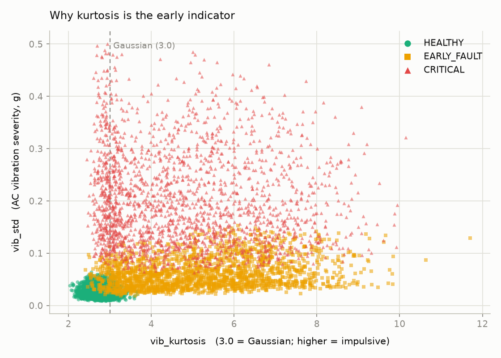

# Edge-AI Predictive Maintenance for Industrial Motors

**A TinyML condition-monitoring node: a random forest trained in Python, compiled
to C, and running real-time inference on a $6 microcontroller.**

Raspberry Pi Pico W · 11 engineered features · 2 kHz triaxial sampling · 512-point
FFT · 4 classifications/second · 98.4% accuracy · 15.7% flash, 33.3% RAM

---

## The problem

Rotating machinery fails in ways that announce themselves weeks in advance — if
anything is listening. Roughly **half of all industrial motor failures originate
in bearings**, and a spalled bearing race radiates a characteristic vibration
signature long before the machine gives any outward sign of trouble.

The two standard responses are both bad. *Run-to-failure* means unplanned
downtime, secondary damage and emergency labour. *Scheduled maintenance* means
replacing healthy bearings on a calendar and still missing the early failures.
Predictive maintenance replaces both with "service it when the data says so" —
and is why Siemens Senseye, GE Proficy and Bosch Nexeed exist.

The barrier is economic. Instrumenting a plant means one node per machine, and a
node that streams raw vibration is unaffordable: triaxial data at 2 kHz is about
**24 kB/s per machine**, so a hundred motors would push 2.4 MB/s of continuous
network traffic, almost all of it describing a machine that is perfectly fine.

**The answer is to move the decision to the sensor.** This project builds that
node end to end.

---

## Architecture

```
  OFFLINE  (laptop, Python)                 │  ON-DEVICE  (Pico W, C++)
  ─────────────────────────                 │  ─────────────────────────
                                            │
  generate_dataset.py                       │   MPU6050 ──┐
    motor physics: shaft harmonics,         │   @ 2 kHz   │
    BPFO + load-zone sidebands,             │             ▼
    impact ring-down, cage slip             │      ring buffer [512]
         │                                  │             │
         ▼                                  │             ▼
  extract_features.py ◄══ SAME MATH ═══════►│   features.cpp
    11 features            SAME ORDER       │     3 axes → PCA → 1 signal
         │                 SAME HASH        │     RMS peak std KURTOSIS crest
         ▼                                  │     512-pt FFT → dom freq
  train_random_forest.py                    │     + 3 band-energy ratios
    sklearn, 15 trees, depth 8              │     + current RMS, temperature
         │                                  │             │
         ▼                                  │             ▼
  export_to_c.py ═══════════════════════════►   model_rf.h
    389 nodes → nested if/else              │     15 trees vote
                                            │             │
                                            │             ▼
  lstm_autoencoder_scaling_path.ipynb       │   HEALTHY / EARLY_FAULT / CRITICAL
    Tier 2 · unsupervised · NOT deployed    │   + degradation index 0–100%
                                            │             │
                                            │             ▼
                                            │   LED · buzzer · OLED · JSON
                                            │   (#ifdef → MQTT northbound)
```

---

## The ML, and why each choice was made

**Features come from vibration theory, not from a feature-selection search.**
Each of the eleven is something a vibration analyst would name on a spectrum:
shaft imbalance at 1×, misalignment at 2×, the bearing outer-race defect
frequency (BPFO ≈ 89 Hz for this 1500 RPM machine) with its load-zone sidebands,
and the structural resonance band the impacts excite.

**Kurtosis is the early-warning feature.** It is the 4th standardised moment —
3.0 for Gaussian noise. A healthy bearing produces near-Gaussian vibration; a
spalled race delivers a sharp impact every time a ball crosses the defect. Those
impacts are brief and rare but large, which is a heavy-tailed distribution.
Kurtosis climbs while overall RMS is still almost normal, because a handful of
short spikes barely move the average energy. That is the whole value: **kurtosis
sees the fault before amplitude does.**

**Random forest, not a neural network**, for four concrete reasons:

| | |
|---|---|
| **It *is* executable code** | A tree is already nested `if`/`else`. No TFLite Micro runtime (~20 kB before your model), no interpreter, no operator kernels. |
| **No feature scaling to keep in sync** | Trees split on raw thresholds. Every normaliser you ship is one more object that can silently drift out of sync with the firmware. |
| **Microseconds on an FPU-less M0+** | ~120 float comparisons per inference, versus thousands of software-float MACs for even a small MLP. |
| **Auditable** | "Why did you stop my line?" has an answer: the decision path, and the feature importances behind it. |

### Two findings that changed the design

**1. The first model scored 100% — and was worthless.** Test accuracy 100.00%,
cross-validation deviation 0.00%, and permutation importance of *exactly zero*
for every feature except `vib_std`. A single amplitude threshold separated all
three classes, and kurtosis — the entire premise — contributed nothing.

The generator was at fault, not the model: absolute vibration amplitude had been
made a giveaway. Real machines vary several-fold in absolute level depending on
sensor mounting, adhesive thickness and load. So a random **mounting/load gain**
(log-uniform, 0.5–2.0×) now multiplies every window. Because it scales all
components together, kurtosis, crest factor and the band ratios are untouched
while amplitude loses its free ride — forcing the model onto exactly the
scale-invariant features that justify computing them.

Result: 98.4%, with importance spread across the feature set and realistic
confusion on the genuinely hard EARLY↔CRITICAL boundary.

**2. High kurtosis is not monotonic with severity.** In an advanced fault the
race is damaged everywhere, impacts merge into continuous broadband noise, and
kurtosis *falls back* toward 3.0 even as RMS goes through the roof. 20% of the
CRITICAL training set models this deliberately, so the forest cannot learn
"kurtosis > 6 = critical" and then downgrade a machine that is about to seize.

---

## Results

| Metric | Value |
|---|---|
| Test accuracy (1500 held-out windows) | **98.40%** |
| 5-fold cross-validation | 98.43% ± 0.36% |
| Model | 15 trees · depth 8 · 389 nodes |
| Inference latency | microseconds (~120 float compares) |
| Classification rate | ~4 Hz (256 ms window) |
| Flash / RAM | **15.7%** (328 kB of 2 MB) / **33.3%** (87 kB of 256 kB) |
| Export fidelity vs. scikit-learn | 0.25% |

**Top permutation importances** — `band_mid_ratio` 0.180, `vib_std` 0.116,
`current_rms_a` 0.072, `vib_kurtosis` 0.062. The single most informative feature
is the energy share in the bearing-defect frequency band, which is the result the
physics predicts.

**Sensor-group ablation** — vibration alone 94.0%, current + temperature alone
82.7%, all eleven features 98.4%. Neither group is sufficient; the fusion is
load-bearing.





---

## The edge-deployment story

The part that is easy to get wrong in TinyML is not the model. It is that the
model is trained on features computed one way and the firmware computes them a
*slightly* different way — a Hann window with the wrong denominator, an FFT band
edge off by one bin, scipy's excess-kurtosis convention instead of the textbook
one. **Nothing crashes. The classifier just becomes confidently wrong.**

Three mechanisms prevent it:

1. **One definition.** Sample rate, window length, band edges (stored as integer
   bin indices so rounding cannot drift), PCA iteration count and feature order
   exist exactly once, in `feature_spec.py`.
2. **Generated, not duplicated.** That file *writes* `firmware/src/feature_spec.h`.
   The firmware hard-codes none of it.
3. **A compile-time tripwire.** The spec is fingerprinted (FNV-1a); the hash is
   baked into both the spec header and the model header, and `main.cpp` carries
   `static_assert(MODEL_FEATURE_SPEC_HASH == FEATURE_SPEC_HASH)`. Change the spec
   without retraining and **the build fails** rather than shipping a model that
   misreads its inputs.

On top of that, `export_to_c.py` re-runs the forest through a float32 replica of
the generated C and reports any disagreement, and an `ENABLE_SELFTEST` build
verifies *on the Pico itself* that `features_compute()` reproduces the Python
reference on raw windows — in float32, with the ARM toolchain's libm, where it
actually matters.

---

## Tier 2 — the scaling path

The deployed forest is supervised, which means it can only recognise faults
resembling its training data. Shown a rotor bar fracture or an inner-race defect,
it has three output slots and will confidently pick one. It cannot say *"I don't
know"*, and the failures that matter most are the uncatalogued ones.

`lstm_autoencoder_scaling_path.ipynb` demonstrates the fix: an LSTM autoencoder
trained on **healthy data only**, using reconstruction error as an anomaly score.
It never sees a fault label. Anything structurally unfamiliar reconstructs badly,
so novel failure modes are flagged without ever having been catalogued. The
notebook shows it detecting an unseen inner-race fault that the forest
misclassifies with high confidence, and sketches the route from anomaly score to
a genuine Remaining Useful Life estimate with uncertainty bounds.

**It deliberately stays off the microcontroller.** Not for size — it would fit —
but because an LSTM needs a tensor runtime and thousands of software-float MACs
on an FPU-less core, its thresholds are machine-specific and drift with wear, and
it is most valuable where it can compare *across* machines. The honest
architecture is **both, at different tiers**: a cheap supervised classifier at the
edge for instant annunciation and safety interlocks, and an unsupervised sequence
model upstream for novel-fault detection and RUL. That split is why the node's
telemetry carries the full feature vector and not just the verdict.

---

## Honest limitations

- **Training data is synthetic.** The physics is grounded, but no real bearing
  was harmed. Accuracy against a simulator you wrote yourself is, on its own, a
  statement about your simulator. Validating against the NASA IMS or Case Western
  Reserve run-to-failure datasets is the next step.
- **The degradation index is a documented heuristic**, not a learned RUL model —
  a weighted sum of five normalised features, auditable by a maintenance
  engineer, and labelled as such everywhere it appears.
- **Wokwi's MPU6050 emits constants, not waveforms**, so the simulator build
  synthesises the vibration from the same physics model and treats the slider as
  a severity knob. This replaces the *sensor* only; the ring buffer, PCA, FFT,
  features and forest are the production code path, unmodified.
